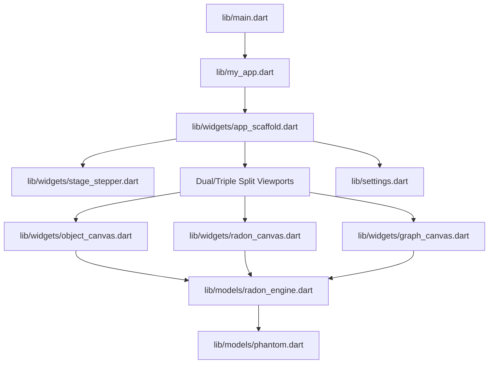

# GEMINI.md - Developer Guide for CAT Scan Demonstration Tool

Welcome! This guide is designed to help future LLM agents and human developers
get up to speed quickly on the **CAT Scan** Flutter application.

---

## Developer Rules & Environment Configuration

All contributors and AI agents must follow the central rules defined in
`~/source/gemini/config/rules/`:

* **Task Management (`todo.md`)**: Project tasks and issues are tracked using
  `~/bin/todo.py`. When asked about tasks or what to work on next, execute:

  ```bash
  ~/bin/todo.py list
  ```

Before starting an item, mark it in progress (`~/bin/todo.py doing <N>`). Once
completed, mark it done (`~/bin/todo.py done <N>`). Do not archive completed
tasks until reviewed and verified.

* **Communication Style (`style.md`)**: Be blunt and direct. Avoid polite
  filler and superlatives. Keep responses concise, technical, and focused
  strictly on facts and instructions.

* **Documentation Formatting (`markdown.md`)**: Keep line lengths strictly
  under 80 characters. Always separate list items with a blank line. Always
  follow headers with a blank line. Visually align markdown table column
  borders (`|`).

* **Emacs Integration (`emacs.md`)**: When requested to send a file to Emacs,
  run `emacs-maybe-client -f <file>`.

* **Hardware & Testing (`devices.md`)**: On host `raven`, an Android device
  may be connected via `adb` for Android testing.

---

## 1. Project Purpose & Features

The **CAT Scan Demonstration Tool** is an interactive, educational Flutter
application (Web and Android) illustrating how Computed Axial Tomography (CAT
/ CT scans) and the Radon Transform work.

The project is adapted from an original 1998/2006 Java applet by **Fred Gylys-
Colwell** ([gchouse.org](http://www.gchouse.org/CAT/talk.html)). It explains:

1. How 1D X-ray projections of an object at different angles form a 2D dataset
   called a **sinogram** ($g(r, \theta)$).

2. The geometric duality between points in object space and sinusoidal curves
   in sinogram space.

3. How backprojection of unfiltered data produces a blurry reconstruction.

4. How filtering projections with a ramp/edge filter (Frank Natterer's
   discrete filter kernel $w_b$) sharpens the data so that backprojection
   yields the exact interior attenuation values.

### Key Features

* **Dual Synchronized Viewports**:

  * **Object Space**: Interactive 2D coordinate plane showing the
    object/phantom, active X-ray lines, and probe points.

  * **Sinogram / Radon Space**: 2D parameter plane $(r, \theta)$ displaying
    attenuation values as an interactive heatmap, with probe cursors and
    sinusoidal curves.

* **1D Profile & Backprojection Graph**:

  * Live cross-sections of $g(r, \theta)$ along chosen angles $\theta$, radial
    offsets $r$, or sinusoidal point trajectories.

  * Real-time calculation and display of the backprojection integral
    $\int_0^{2\pi} g(x\cos\theta + y\sin\theta, \theta) \, d\theta$.

* **Guided 6-Stage Narrative**: Step-by-step presentation following the
  original talk structure with rich narrative cards, Previous/Next navigation,
  and keyboard shortcuts.

* **Customizable Settings**: Persistent theme (Dark / Light), colormaps
  (Classic Java purple-red-yellow, Viridis, Grayscale), grid sampling
  resolution ($P \times Q$), and coordinate guides.

* **No File/Drive Storage**: The app is an explanatory tool; file saving and
  Google Drive integration are omitted.

---

## 2. Codebase Architecture



### Directory Structure

```text
cat/
├── android/              # Android native packaging
├── assets/               # Runtime assets (icons, compiled html docs)
│   ├── css/              # Documentation styling (doc_style.css)
│   ├── dev/              # Developer HTML documentation
│   └── icons/            # App icons (icon.png, foreground.png, background.png)
├── doc/                  # Markdown source documentation
│   └── info.md           # User-facing Information page
├── html_tweak/           # Local HTML version injection tool
├── lib/                  # Dart/Flutter source code
│   ├── models/           # Mathematical models (radon_engine, phantom)
│   ├── widgets/          # Viewport canvases, stage stepper, dialogs
│   ├── color.dart        # Colormaps and palette utilities
│   ├── my_app.dart       # Material App configuration and theme management
│   ├── settings.dart     # Persistent preferences (shared_preferences)
│   └── main.dart         # Main entry point
├── test/                 # Automated unit and widget tests
├── web/                  # Flutter web shell and manifest
├── Makefile              # Automation for assets, docs, build, testing
├── plan.md               # Detailed project plan and milestone tracker
├── GEMINI.md             # This developer guide
└── README.md             # Project overview and public documentation
```

---

## 3. Mathematical Reference & Coordinate Conventions

### 3.1 Object Coordinates

* The object space is normalized to $[-1, 1] \times [-1, 1]$.

* Origin $(0, 0)$ is at the center of the viewport.

* Standard Cartesian coordinates: $+x$ points right, $+y$ points up (unlike
  screen pixel coordinates where $+y$ points down).

### 3.2 Sinogram Coordinates

* Angle $\theta \in [0, 2\pi)$ discretized into $2P$ samples: $\theta_j = \pi
  j / P$, for $j \in \{0, \dots, 2P - 1\}$. Default $P = 50$.

* Radial distance $r \in [-1, 1]$ discretized into $2Q$ samples: $r_i = (i -
  Q)/Q = h \cdot i - 1.0$, with step $h = 1/Q$. Default $Q = 50$.

* Line equation: $x \cos\theta + y \sin\theta = r$.

### 3.3 Phantom Line Integral

For a circular phantom disk with radius $r_p$, center $(x_0, y_0)$, and
uniform density $1$:

$$s_c(\theta) = x_0 \cos\theta + y_0 \sin\theta$$

$$\Delta s = r - s_c(\theta)$$

$$\psi(\Delta s) = \begin{cases} 2\sqrt{r_p^2 - (\Delta s)^2} & \text{if } |\Delta s| < r_p \\ 0 & \text{otherwise} \end{cases}$$

### 3.4 Ramp Filter Kernel (Frank Natterer)

Discrete filter kernel for bandwidth $b = \pi Q$:

$$w_b(l) = \frac{b^2}{\pi^4 (1 - 4 l^2)} \quad (l \in \mathbb{Z})$$

Filtered sinogram:

$$(w_b * g)(r, \theta) = h \sum_{l = -L}^{L} g(r - l h, \theta) \, w_b(l)$$

---

## 4. Development Workflows & Local Commands

### 4.1 Running the App Locally

* **Local development server (Chrome)**:

  ```bash
  ./run-local-server.sh
  ```

Uses port `5515` on host `raven` and port `5006` on remote hosts.

* **Local release build test**:

  ```bash
  ./run-local-release.sh
  ```

### 4.2 Building Assets & Docs

* **Rebuild documentation and icons**:

  ```bash
  make ASSETS
  ```

* **Run automated tests**:

  ```bash
  make test
  # or: flutter test
  ```

* **Analyze Dart code**:

  ```bash
  flutter analyze
  ```

* **Increment build version**:

  ```bash
  ./roll_build_number.sh            # Increments build number (e.g. +1)
  ./roll_build_number.sh --release  # Increments release version (e.g. 1.0.1+0)
  ```

---

## 5. Engineering Guidelines & Quality Standards

1. **Precision & Documentation Integrity**: Preserve comments, docstrings, and
   mathematical notations when modifying or extending files.

2. **Analysis Hygiene**: Always keep `flutter analyze` clean (0 errors, 0
   warnings).

3. **Responsive Custom Painting**: Use `CustomPainter` efficiently. Precompute
   trigonometric lookup tables ($\sin$, $\cos$) and cache rasterized heatmaps
   so dragging the phantom or probe remains smooth at 60 FPS.

4. **File Links**: When discussing code, reference file paths with standard
   clickable markdown links (e.g.,
   `[RadonEngine](lib/models/radon_engine.dart)`).
